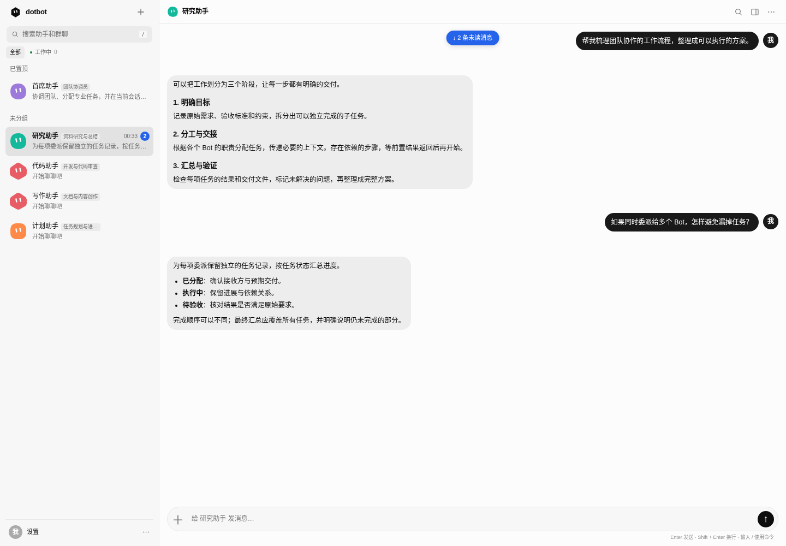
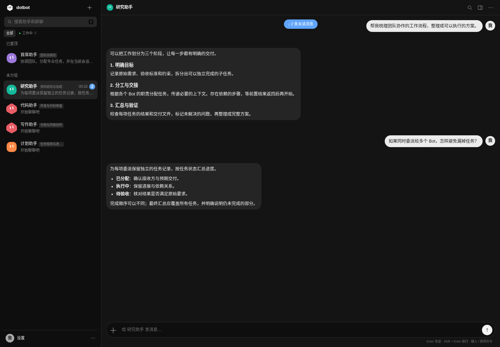

# dotbot


> 测试版：功能仍在迭代，截图使用隔离测试团队与演示数据，不包含真实账号或密钥。

## 测试版截图

桌面端团队工作区：



网页端深色主题：



## GitHub 自动打包

推送到 `main` 或手动运行 Actions 会构建源码包和 Linux x86_64 服务端安装包；推送 `v*` 标签时自动创建 GitHub Release。发布文件全部由 GitHub 构建，不上传本地预制包或完整 Docker 镜像。网页端已嵌入服务端，无需单独安装前端。当前不发布移动端。

## Docker 部署与开源打包

Linux Docker Engine + Compose 插件：

```sh
docker compose build
docker compose up -d
docker compose logs dotbot
```

打开 `http://127.0.0.1:4870/login`，使用首次启动日志中的初始密码完成管理员设置，模型密钥在页面录入。数据持久化于宿主 `/srv/dotbot`；此部署挂载 Docker socket 并使用 host 网络，适用于可信 Linux 主机，不适用 Docker Desktop。公网部署需 HTTPS 反向代理与 `--public-url`。详见 [Docker 部署](deploy/docker/README.md)。

```sh
# 源码发布包：自动排除密钥文件、运行数据、编译产物和依赖缓存
bash deploy/source-package.sh
# 可转移镜像包：主服务 + webtop 基础镜像 + Compose + 校验文件
bash deploy/docker/package.sh
# 原生 Linux 静态二进制及安装器
bash deploy/package.sh
```

包输出到 `dist/`，不提交到源码仓库。发布源码时使用源码包解压目录，检查文件清单后再推送。操作说明、排除范围和发布检查见 [GitHub 发布与打包](docs/open-source-release.zh-CN.md)。

## 开源许可与致谢

自有代码采用 [Apache-2.0](LICENSE)。本项目参考 DS Bot 的团队、记忆格式和部分提示词，并移植定制了 MIT 许可的 pi-agent-core；其上游许可均保留。其他构建、桌面和测试依赖见 [第三方开源说明](THIRD_PARTY.md)、[NOTICE](NOTICE) 与 [Rust 许可清单](licenses/RUST-DEPENDENCIES.md)。本项目与 Grok Bot 官方无隶属关系。

Formerly teambot. The executable, UI and deployment service are now named `dotbot`. New installs use `~/.dotbot`; existing `~/.teambot` teams and `~/teambot-workspace` workspaces are automatically reused when their new equivalents do not exist. `--home` takes priority over `DOTBOT_HOME`, then legacy `TEAMBOT_HOME`. Other `DOTBOT_*` environment variables also accept their old `TEAMBOT_*` aliases; new values take priority. Existing secrets support both prefixes. Internal state filenames, MCP tool namespaces, the administrator cookie name and desktop identifiers stay stable. Legacy startup-token links and cookies no longer grant access.

A team of long-lived Bots that runs on your computer, written in Rust, with its own Rust agent engine (a port of pi's agent loop) that talks to any Anthropic- or OpenAI-compatible model API.

- **Bots with roles.** Every Bot is a long-lived identity with its own name, role, description, instructions, model, working folder, memory and browser. Research, writing, development, planning and event-monitor templates are available in English and Chinese. A pinned Chief routes work by responsibility; Main Bots manage the team. User-facing replies, progress, collaboration summaries and memory summaries use Simplified Chinese independently of the UI locale; exact technical text and explicitly requested foreign-language artifacts are preserved.
- **Bots talk to each other.** `message_bot` creates a tracked task with optional context, expected output and acceptance criteria; its receipt ID, answer and delivered files return to the original conversation. Original requirements and delegation chains remain available after asynchronous replies. `list_tasks` inspects work assigned to a Bot or requested by its conversation without polling. Duplicate requests are reused within the same parent task; stopping a conversation or parent task cancels dependent work while preserving unrelated queued requests. Every collaborator keeps its own configured model and permissions.
- **Automatic coordination.** Main Bots and groups select existing specialists by role, permissions and current load without requiring manual delegation. The pre-reply planning model (the provider default unless set under Models for background jobs) selects up to four distinct specialists for independent work. Different Bots execute concurrently; each Bot shares one execution slot between its private chat and delegated sessions, while each of its group seats has its own, so group work and private work run in parallel. Queued user requests take precedence over background updates; work within each class stays FIFO. Dependent steps wait for prerequisite results. Simple requests and requests to work alone stay with the coordinator. An explicit request to delegate first reuses a suitable existing Bot without changing its settings, including in non-Main chats and every group mode. Only when none is suitable does it create a dedicated Bot inheriting the originating Bot’s settings. Results return here; retries reuse the same durable assignment. Invalid or timed-out explicit selection reports failure without creating a replacement. Invalid or timed-out ordinary automatic plans fall back to direct handling. A message sent while work is running joins that work without a mode switch: the working Bot decides whether it amends the task or is a separate request to handle afterwards; if the work already ended, it is sent as a new message. The conversation menu can clear a conversation's chat history (refused while it is working; memory, tasks and files stay). See the [collaboration guide (中文)](docs/collaboration-and-skills.zh-CN.md).
- **Group chats.** A message that @-mentions nobody is claimed by the members it concerns: each member decides in parallel, on the planning model, whether part of it is its job, and only claimers reply, each doing its own part. When nobody claims anything the admin (or first member) takes it and may allocate it among members in group-specific sessions; results and synthesis appear in that group. `@Name` calls a member, `@all` everyone. The group panel has no reply-mode or folder settings; a member replying in a group is shown as "replying to you" there and does not appear busy in its own chat. Every member retains its Bot model. Existing default admin groups upgrade once; subsequent explicit mode choices are retained. Mention-driven rounds stop after 8 replies.
- **Memory that carries over.** The same Markdown files as DS Bot (Agent Memory Repo format): `MEMORY.md` and topics per Bot, per group and for the team, with a change journal. A DS Bot team folder opens as it is.
- **Opt-in local terminal collaboration.** Enable it in Settings to run commands, build projects and work with local files on the machine running dotbot. Bots coordinate access to shared files; approvals, pause, timeout and cancellation remain enforced. No local GUI control is included. See the [local terminal guide (中文)](docs/local-terminal.zh-CN.md).
- **Remote desktop first.** Bots operate their remote computer through screenshots and desktop controls; commands and file processing run on that desktop when needed. Claude Code's built-in host file and shell tools are disabled; opt-in local work uses dedicated `local_*` tools. Tool traces stay out of chat; results and delivered files remain visible, and the desktop panel shows live work. Search tries WebSearch, then another available search tool, before falling back to the remote browser.
- **You approve risky steps.** Steps the Bot's permission policy holds back appear as an Allow / Deny card. Remote commands and application launches follow the Bot's permission policy. Read-only mode and user takeover are enforced by the server, including the browser MCP gateway.
- **Unified settings.** Routines, skills, connections, messaging platforms and models live behind the profile/settings button; the sidebar stays focused on conversations. Desktop settings have a section menu, and phone settings use horizontal navigation.
- **Messaging platforms.** Talk to a Bot or a group chat from WeChat, QQ, Feishu/Lark, DingTalk or Telegram. Each is reached from your computer with no public address: WeChat by QR sign-in (iLink bot API), QQ over the official bot gateway, Feishu over its long connection, DingTalk in Stream mode, Telegram by long polling. Only allowed senders get through (others show on the page with an Allow button); `/new` and `/stop` work from the chat. Connection and send errors, last activity, reconnect and sender access controls are available in Settings → Social platforms. See the [setup guide (中文)](docs/social-platforms.zh-CN.md).
- **Routines.** A prompt goes to a Bot or group on a schedule (daily, weekdays, weekly, every N minutes, once) in an IANA timezone, or through a generic webhook, signed GitHub/Slack event, or Teams Workflow. Edit, pause and resume routines; inspect persisted run results. Settings guides event setup, tests signatures and filters without invoking a model, and distinguishes subscription registration from real incoming events. GitHub supports hook registration, provider ping, status and removal. Event IDs prevent provider retries from repeating work; independent events queue separately. Bots can create and update routines themselves.
- **Learning loop (Hermes-style).** Bots persist knowledge inside the turn that produced it, with no extra model calls: after a complex task (about five or more tool calls, or a fix found after a failure) they write a reusable workflow with `save_skill` or patch one they used, and note short facts and lessons with `remember`. Workflows a Bot wrote are patched in place with revision checks; imported and user-written skills still go through staged candidates and paired regression. Bots recall older work on demand with `search_history`, which searches their own private chat and the groups they belong to. Earlier lessons are matched locally, without a model call. Bots decide which skills to use; the Bot details panel has no skill settings. The optional Curator (Settings → Skills, off by default) reviews finished tasks while idle with one extra model call per task and tests skill changes with paired candidate runs.
- **Automatic skills and individual specialties.** Before substantive tasks, the pre-reply planning model selects relevant workflows for each Bot, import from a curated official `anthropics/skills` catalog, or write a role-specific workflow when missing (including fallback when a source is unavailable). Prepared workflows apply in the same turn. Imports preserve scripts, references, assets, licenses and source versions without executing scripts. Bots keep separate preferred skills and persistent loading profiles, which inform automatic task allocation; shared skills remain accessible to everyone. New workflows start untested: loads and completed turns are not quality verification. Settings manages installed workflows, sources and enable/disable without a public catalog; Bot details shows preferences and history. Revision checks reject conflicting edits, and disabled skills stay disabled. See the [skills guide (中文)](docs/collaboration-and-skills.zh-CN.md).
- **Shared accounts.** Sign in once with Google (Gmail, Calendar, Drive, Docs, Sheets, Contacts, Tasks, Photos), GitHub or Microsoft 365, choose per-service access, test real API access, refresh expired grants and revoke access. Bots use server-side API tools; account writes require approval. Custom MCP connections have real initialization/tool-list tests. See the [accounts, events and recovery guide (中文)](docs/accounts-events-recovery.zh-CN.md).
- **Recovery and delivery.** Execution inputs, checkpoints and action receipts survive restarts. Interrupted tasks require checkpoint review before deliberate continuation. Social replies use a durable per-part outbox with visible retry and an explicit review for uncertain sends. Completed delegation results are reconciled back to their requester.
- **Connections and keys.** Team-wide MCP servers (GitHub, Notion, …): connect once, every Bot has it. Keys come through a secure card (`request_secret`), reach a Bot's shell as `$DOTBOT_SECRET_<NAME>`, fill `${NAME}` in connections, and are blanked out of everything shown or saved.
- **One shared computer, independent Bot screens.** All Bots use the same container, installed software and `/config` files; each has its own screen and session bus. Browser profiles persist per screen and automatically synchronize supported website login state across Bots. The desktop panel shows the Bot’s actual desktop browser and applications. Open a website from its address bar or use the Browser, Files and Terminal shortcuts; take control to interact, then give it back to the Bot. Websites reuse this desktop’s existing browser profile and logins. Desktop mode never starts a second standalone browser or exposes its MCP tools.
- **Team overview, cards and notifications.** One page shows what every Bot is doing and everything waiting for you (approvals, questions from `ask_user`, key cards); desktop notifications when the page is in the background.
- **Memory review.** After a chat goes quiet, the model reads what is new and keeps what lasts, so memory does not depend on a Bot calling `remember`. The memory panel lists entries and answers or changes them from a question.
- **Files in every chat.** Upload, paste or drop attachments into Bot and group chats: up to 8 files, 25 MiB each and 50 MiB per message. Images and PDFs reach the model as native content, text gets a bounded preview, and other formats use enabled file tools. Delegated work returns files to the requester and social channel; model failures and cancellations get explicit replies. See [files and history (中文)](docs/files-and-history.zh-CN.md).
- **Complete retained history.** Page through Bot and group archives, search all retained message text and attachment names, restore reading position and see unread counts across clients. Old group messages already discarded by earlier versions cannot be recovered.
- **Faster replies.** Skill selection, lesson retrieval and automatic allocation run in parallel on the planning model (pick a fast one) before a turn, so the wait is the slowest of them rather than their sum. The Bot's own model still writes the reply.
- **MCP store from a domestic marketplace.** The store lists the 300 most viewed servers dotbot can run from ModelScope's MCP 广场 (modelscope.cn/mcp), ranked by its view counts and kept only if they have a Chinese description and an npx/uvx command or streamable-HTTP address (nothing is fetched from GitHub). Cards show the Chinese name and summary; the details window shows what the server runs, the keys it needs and links to its ModelScope page. Adding asks only for missing keys (stored as keys, never in the connection), shows the exact command first and warns that it runs on the dotbot computer. Manual install also accepts a pasted README configuration (mcpServers JSON, an npx/uvx command or `claude mcp add`). Refresh the snapshot with `python3 -I dev/mcp-store-index.py src/mcp_store.json`.
- **Default reasoning effort per provider.** A text provider can set the reasoning effort (off, minimal, low, medium, high, extra high, maximum) from a select on its card or in its edit window. Every Bot without its own level follows it; a Bot's own level, or Off, wins. Empty sends no reasoning setting, so the model decides. Background jobs keep their own defaults, and a model that does not support reasoning may refuse the request.
- **Compact lists.** Routines, installed plugins, the skill and MCP stores and connected social platforms show small cards with search and pages of 8–12; a card opens its details and actions in a window, and adding or editing happens in a form window. The side panel has no Workspace tab or Back button: its panels (details, memory, activity, desktop, terminal) open from the conversation menu, and when they overlay the chat they close with ✕.
- **Smoother navigation.** First loads show skeletons; recently visited chats and settings show cached content immediately. Reading positions and settings drafts survive navigation, unchanged messages and previews keep their DOM nodes, and stale responses cannot replace the current page. Slow or failed requests offer retry while retaining readable content. Skeletons support mobile layouts and reduced motion. See [loading behavior (中文)](docs/loading-ui.zh-CN.md).

## 发布范围

当前仅发布网页端与 Rust 服务端，包含 Docker 部署和 Linux 服务端安装包。移动端客户端暂不发布，不包含在本次源码包中。

## Storage

The server now saves team metadata and chats in SQLite by default, importing existing JSON once while keeping the original files. Attachments, memory, skills, desktop files and administrator authentication files stay on disk. See [SQLite storage and backup](docs/sqlite.zh-CN.md). Unmigrated teams can retain the legacy backend with `--storage json`.

## Run

You need Rust and Docker (for desktop browsers and apps). Claude Code is not used: Bots run on dotbot's built-in Rust agent engine (`crates/pi-agent-core`, a Rust port of pi's agent loop), which calls your model provider directly. After signing in, add a provider with its API key in Settings → Models & providers (Anthropic Messages or OpenAI Chat Completions, including DeepSeek, Kimi, GLM, Qwen, OpenRouter or a local Ollama).

```sh
cargo build --release
./target/release/dotbot serve
# open: http://127.0.0.1:4870/login
```

Open the address it prints. On first installation, the server creates the sole administrator account `admin` and prints a unique initial password once. Sign in with it to open the two-step setup wizard: choose your username and a new password, then your nickname and optional bio. Initial sessions last 15 minutes and cannot access chat, files or desktops; completing setup revokes them and requires login with the new credentials. Existing administrator accounts and profiles are preserved. You can alternatively configure credentials before startup with `dotbot admin-password --username owner` while the service is stopped, using the same `--home`; this skips the wizard and also recovers lost credentials. Settings → General → Account and security lets you change the username, password, or both after verifying the current password; saving revokes all sessions. There is no public registration or startup-token login. The server listens on 127.0.0.1 only; public deployment also requires `serve --public-url https://your-domain`, behind an HTTPS reverse proxy. See [ARM64 deployment and administrator login (中文)](deploy/README.md).

Options: `--home` (default `~/.dotbot`), `--port`, `--workspace` (where Bots without a folder work, default `~/dotbot-workspace`), `--no-desktop` (explicit legacy standalone-browser mode), `--no-browser`, `--headed` and `--browser-command` (standalone mode only), `--public-url` (the trusted HTTPS origin for administrator login and webhooks). Docker and the configured webtop image are required for desktops; inspect `serve --help` for desktop options.

See the [deployment guide](deploy/README.md) for an always-on server, systemd, HTTPS proxying and backups. No service is installed automatically.

Dependency plans, unified acceptance, pause/resume, skill trials/version rollback and platform latency diagnostics are documented in the [workflow guide (中文)](docs/workflows-quality-diagnostics.zh-CN.md).

## Bring a DS Bot team

```sh
dotbot --home ~/.dotbot import ~/.dsh/bot      # or ~/.ds-bot/bot from the DS Bot app
```

This copies `state.json` (Bots, Main Bots, groups and their logs, everything else as it was) and the `memory/` folder. The source is only read. DS Bot's own one-to-one chats live in DeepSeek Harness sessions and do not come along; every Bot starts a fresh conversation with its memory. Fields dotbot does not use are kept, so the folder stays readable by DS Bot.

## Compared with Grok Bot

dotbot targets the Grok Bot team-assistant workflow described by the third-party sources below, using Claude Code on your own computer or server. The following is a capability mapping, not a claim of verified equivalence to an official release. See the [detailed alignment and validation checklist (中文)](docs/grokbot-parity.zh-CN.md).

| Grok Bot | dotbot |
|---|---|
| Agents with a name, title and description; work is routed by description | Bots with name, role and description; `list_bots` shows descriptions and the prompt makes Bots hand work to the Bot whose description fits |
| Chief of staff over specialist agents; pinned leadership agents | Main Bots create, change and stop Bots; pinned Bots head the list |
| Agents hand work to each other | Durable delegated tasks, automatic replies and file return, deduplication, loop prevention, cancellation and results |
| Group chats | Group chats with an admin, `@Name`, `@all`, a round limit and a shared group memory |
| A persistent computer and browser per agent; watch it and take over; logins persist and are shared | One persistent Docker computer per team, shared software and files, and independent Bot screens with live takeover. Managed Chromium profiles synchronize login cookies and explicitly selected Local Storage keys/IndexedDB databases, including logout and restart recovery. Website conflicts pause that site until an explicit source choice; unselected application data is excluded. |
| Teach a task → skill | Bots write skills (SKILL.md) that the engine's Skill tool loads; recorded browser teaching remains available in explicit standalone mode |
| Routines on a schedule or a trigger (Slack, GitHub, webhooks) | Timezone-aware schedules, signed Slack/GitHub events, Teams Workflows and generic webhooks; filters, retry deduplication and run history |
| Connections shared by every agent | Shared OAuth accounts with scopes, refresh/revoke and API tests; team MCP servers with protocol checks |
| Memory, approvals | Memory (per Bot, group and team) with a review after each chat; approvals for risky steps |
| Web client | Responsive browser interface; native mobile clients are not included in this release |

dotbot runs where you start it. Continued execution with your laptop closed requires an always-on server; managed cloud computers, mobile background push and automatic Slack/Teams subscription provisioning remain outside this implementation. GitHub repository hooks can be managed from Settings.

## How it works

```
page (web/)  ── POST /api/bot {method, params}, GET /api/bot/feed (SSE) ──  dotbot server (axum)
                                                                              │
                     one turn = native pi-agent loop (src/pi_agent.rs, crates/pi-agent-core)
                                 model ⇄ provider API (Anthropic Messages or OpenAI Chat Completions, SSE)
                                 team tools → POST /internal/tool (auth, permissions, approvals)
                                 browser + connections → built-in MCP client (stdio / streamable HTTP)
                                 skills → listed in the system prompt, loaded with the Skill tool
                                 session → <home>/pi-sessions/pi-<uuid>.json
```

- A conversation is a Bot chat (`bot:<id>`) or a group member seat (`room:<group>:<id>`). Different Bots execute concurrently, with one cancellable execution slot per Bot across all its sessions. User inputs precede queued background updates. Each request retains its attachments, settings and session; delegated work returns ordinary messages and files.
- The engine calls the team tools through `/internal/tool`, so permissions, takeover and approvals stay on the server. Connection tools pass the Bot's permission policy (`approve`) before they run. `dotbot mcp` still exposes the Bot tools as a stdio MCP server for an external MCP client.
- Conversations share one sidebar and a single + menu for creating Bots and groups. User messages show the profile avatar. Each group member uses its own Bot model settings, just as in a direct chat; groups never override member models. Legacy group overrides are removed on startup, and changing a Bot model refreshes its direct and group engine sessions while preserving history and memory.
- Direct and group chats share message Edit and Stop controls, revealed together on hover or keyboard focus and always available on touchscreens. Editing sends a new message after the stop request succeeds; the original stays in history. Stopping a direct-chat message preserves other queued requests; stopping a group cancels the current round, including members that have not answered yet, while independent chats keep running. Assignment cards distinguish running and queued jobs, and individual tasks can be stopped without interrupting other workers.
- Transient model stream failures get up to two retries with the same Bot model and session, provided no tool has run. Stop also cancels retry backoff. Failures after tool use keep the task for review instead of replaying operations; exhausted stream failures retain incomplete text with Chinese guidance in the UI.
- In normal desktop mode, `desktop_browser` opens the visible desktop browser and every subsequent step uses `desktop_*` tools. See [desktop browser and apps](docs/desktop-browser.zh-CN.md). Docker being unavailable does not silently switch to a second login environment.
- Only in explicit `--no-desktop` standalone mode, each Bot's browser is one long-lived Playwright MCP server with the Bot's profile folder (`<home>/browsers/<id>`). Claude Code reaches it through an authenticated gateway that enforces takeover and read-only policy; the browser panel uses the same browser. On Linux, a restart can reattach to an orphaned headless MCP server whose ancestry and exact profile match Chromium’s live lock; it preserves existing login state and never force-unlocks another running instance. Empty-cookie exports do not replace shared logins.
- Prompts are maintained in [`prompts/`](prompts/README.md): shared team/computer/voice/language rules, Chief responsibilities and specialist templates. Runtime context states which computer, browser and permissions actually exist. User-facing communication stays in Simplified Chinese independently of the page locale; explicitly requested foreign-language artifact content and exact technical text are preserved.
- The memory section of the prompt is frozen per conversation (`memory/snapshots/`), so the prompt stays the same from turn to turn and the prompt cache holds; `recall` finds what was saved since.

| File | |
|---|---|
| `<home>/state.json` | The team, in DS Bot's format |
| `<home>/teambot.json` | Engine sessions per conversation (files in `<home>/pi-sessions/`), what each member has read in a group, the team workspace |
| `<home>/memory/` | Memory, in DS Bot's format |
| `<home>/chats/` | What each conversation shows, one JSON line per item |
| `<home>/reading.json` | Shared per-conversation read progress and viewport anchors |
| `<home>/media/` | Screenshots, images and delivered files |
| `<home>/local-computer.json` | Local terminal opt-in and pause state (off by default) |
| `<home>/tasks.json` | Delegation receipts and results, reused during reviewed continuation |
| `<home>/recovery.json` (owner only) | Durable execution inputs, progress, action receipts, results and return deduplication |
| `<home>/outbox.json` (owner only) | Social delivery parts, confirmation cursor and retry/review state |
| `<home>/accounts.json` (owner only) | OAuth apps, scopes, grants, refresh tokens and account status |
| `<home>/connection-checks.json` (owner only) | Actual MCP initialization and tools/list evidence |
| `<home>/event-settings.json`, `event-status.json` (owner only) | Public callback origin and local/provider event evidence |
| `<home>/routine-runs.json` | Automation run history and retained event IDs for deduplication |
| `<home>/routines.json`, `connections.json`, `secrets.json` (owner only) | Routines, team connections, keys |
| `<home>/channels.json` (owner only) | Messaging platforms: settings, allowed senders |
| `<home>/plugin/` | The team's skills (`skills/<name>/SKILL.md`), listed to every turn |
| `<home>/learning.json` | Curator records: scoped reusable experience and deduplicated skill refinements |
| `<home>/skill-profiles.json` | Individual Bot skill loading history (preferences are in Bot settings) |
| `<home>/disabled-skills/` | Disabled shared skills, including their supporting resources |
| `<home>/desktops/` | Shared computer home (`shared/`), stable screen assignments, runtime sockets and migration record; legacy Bot directories are retained on the host but no longer mounted |
| `<home>/browsers/` | Legacy standalone browser profiles and shared cookies; desktop mode uses `<home>/desktops/` |

## Develop

```sh
cargo test                  # unit tests: memory format, state.json, engine protocols, MCP, skills
cargo clippy --all-targets -- -D warnings
cargo build && node dev/e2e.mjs   # end to end, with dev/fake-model.mjs as the provider: no key, no cost
node dev/provider-effort.e2e.mjs   # a provider's default reasoning effort reaches the model request and Bot overrides win
node dev/learning.e2e.mjs         # opt-in Curator: task evidence, reflection/reuse, skill refinements, preemption and restart
node dev/inline-learning.e2e.mjs  # default in-turn learning: no review/retrieval model calls, in-place patches of Bot skills, search_history scope
node dev/skills.e2e.mjs           # same-turn skill creation/import, resources, permissions, profiles and restart
node dev/admin-auth.e2e.mjs       # administrator sessions, revocation, CSRF, rate limits and public startup rules
node dev/admin-login-ui.e2e.mjs   # real HTTPS login, settings, desktop/mobile themes and browser cleanup
node dev/setup.e2e.mjs            # first-install setup, restricted sessions, restart and SQLite profile
node dev/coordination.e2e.mjs     # automatic Main/group allocation, models, isolation, fallback and Stop
node dev/multi-mention.e2e.mjs    # multiple @ recipients, overlapping rounds, ordered handoffs and out-of-order replies
node dev/delegation-media.e2e.mjs # explicit delegation reuses suitable Bots; image/video prompts stay out of SSE/history/captions
node dev/delegation-attachments.e2e.mjs # inherited/selected attachments, nested handoffs, native inputs and binary copies
node dev/groups.e2e.mjs          # conversation folders, persistence, failed context and stale group model recovery
node dev/integrations.e2e.mjs # OAuth/PKCE, MCP, event setup, durable delivery and actual restarts
node dev/desktop.e2e.mjs    # one test computer, independent Bot screens, shared software/files, takeover and mobile UI
node dev/shared-desktop-migration.e2e.mjs # legacy applications/files, no old-home mounts and service restart
node dev/desktop-resources.e2e.mjs # shared resource coordination, cancellation and preserved browser on upgrade
node dev/restart.e2e.mjs # persistent web sign-in, explicit revocation and service replacement
node dev/browser.e2e.mjs    # MCP profile reattachment, concurrent startup, shared-cookie preservation and cleanup
node dev/channels.e2e.mjs   # local Telegram and WeChat fixtures: no real accounts
node dev/attachments.e2e.mjs # file privacy, native inputs, group archives, search and read state
node dev/local.e2e.mjs     # opt-in terminal and file collaboration
DOTBOT_CHROME=/opt/google/chrome/chrome node dev/routing-learning-ui.e2e.mjs # candidate UI on desktop/mobile
npm ci --prefix dev
# Install Chromium first: cd dev && npx playwright install chromium
node dev/skills-ui.e2e.mjs   # installed skills without a public catalog, drafts, provenance and mobile Bot preferences
node dev/groups-ui.e2e.mjs   # Chinese folders, collapse/search, mobile layout and centered creation button
node dev/loading-ui.e2e.mjs # slow/failing requests, skeletons, caches, drafts, scroll and stable media previews
node dev/ui.e2e.mjs          # one real browser; alternatively set DOTBOT_CHROME to an installed Chrome
# Verify embedded assets and new APIs in an isolated release service:
cargo build --release && node dev/release.e2e.mjs
```

`dev/fake-model.mjs` is a local Anthropic Messages service: a prompt line `TOOL <name> <json>` makes it call that tool, which the real engine runs. The harness points the team at it and sets `DOTBOT_TEST_MODEL_HEADERS=1`, so requests carry test-only headers (conversation, working folder, session) that it logs in the old CLI-argument shape.

The integration suites use temporary team folders and clean up their own services. UI checks reuse one browser, context and page, save desktop/phone screenshots in `test-results/`, and verify browser cleanup. Model responses, platform events and the Bot-browser MCP server are fixtures; `dev/desktop.e2e.mjs` separately verifies a real isolated Docker desktop with a local website; no test validates real account access or paid-model quality.

## Notes

- Models: a Bot's model is a model id of the provider in use; empty means the provider's default model. Background jobs each name a model id too (Settings → Models & providers), the default when empty. There are no Claude Code tiers or built-in provider.
- Billing and model access are your provider account's; keys stay in `<home>/providers.json` (owner-only) and never reach the page or the model.
- Each turn gets exactly the team tools, the enabled connections and (in standalone mode) the Bot's browser; nothing else on the host is loaded.
- Background jobs (memory review and panel, auto-approval, planning, verification) are one-shot structured requests: the model must answer by calling a single `structured_answer` tool.
- Long sessions: before a request would exceed the provider's context window (set per provider, default 128k tokens), the engine summarizes the older part into one stored summary message (goals, deliverables, external actions already taken, delegations, next steps) and keeps the recent exchanges verbatim. The stable system prompt, tools and conversation carry Anthropic cache breakpoints; per-turn context goes after them. Bots research with the built-in `web_search` and `web_fetch` (public addresses only).
- Ordinary browser steps and permitted team tools run without asking; remote commands, app launches and other approval requests follow the Bot's policy. User takeover and read-only mode can block actions regardless of model instructions.
- Sources on Grok Bot: [MindStudio: What is Grok Bot](https://www.mindstudio.ai/blog/grok-bot-ai-agent-fleet), [MindStudio: building a Grokbot team](https://www.mindstudio.ai/blog/how-to-build-grokbot-agent-team).

Licensed under Apache 2.0. See NOTICE.

```sh
node dev/concurrency.e2e.mjs # specialist concurrency, priority, group isolation and targeted stop
node dev/serial-chat.e2e.mjs # per-Bot scheduling, ordinary delegation, removed feature regression
DOTBOT_CHROME=/opt/google/chrome/chrome node dev/serial-chat-ui.e2e.mjs # simplified desktop/mobile UI
```
